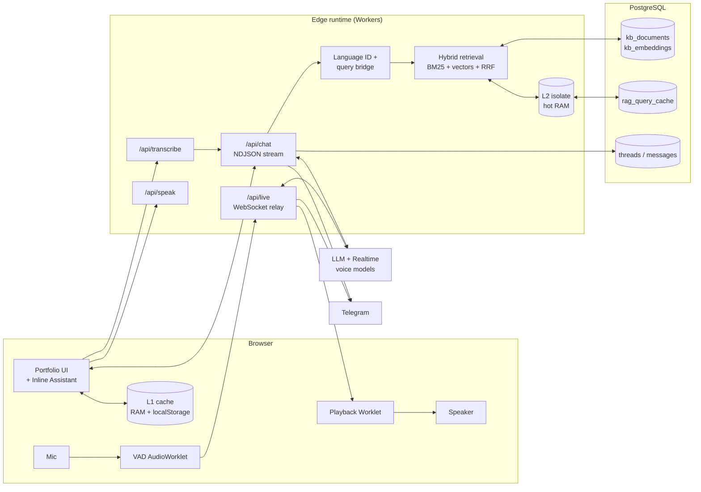
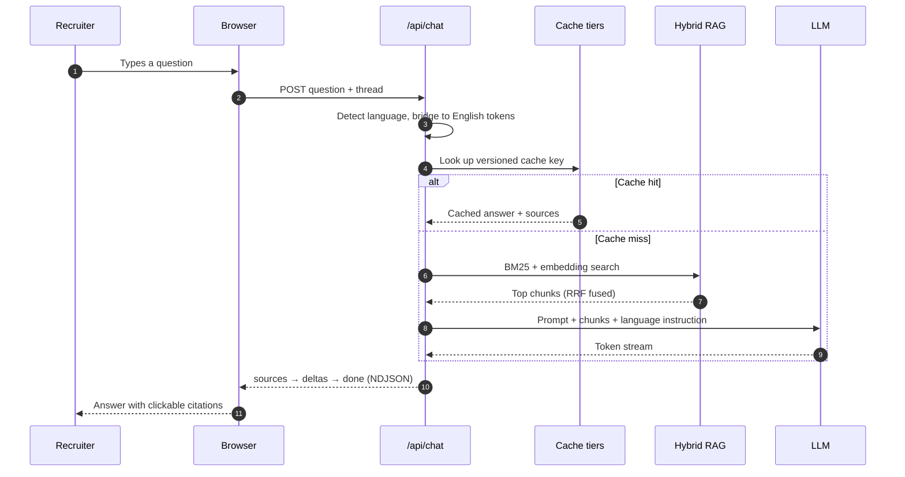
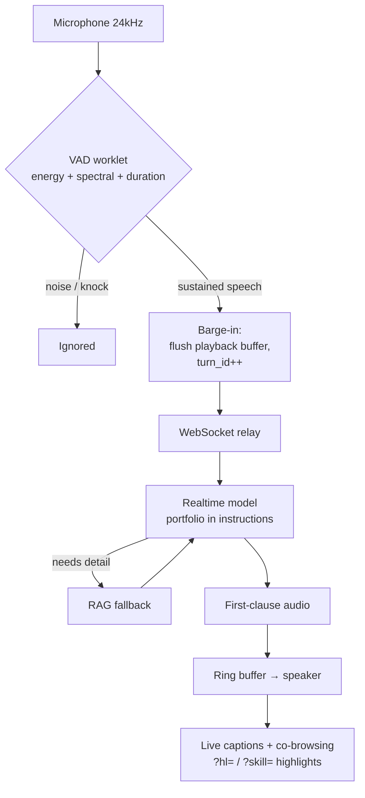
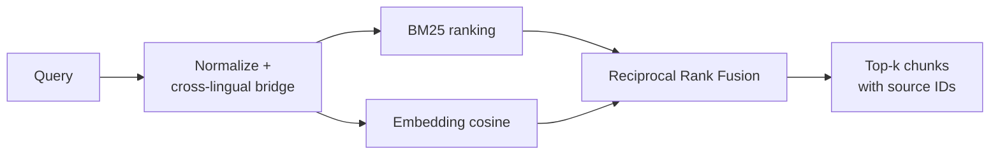
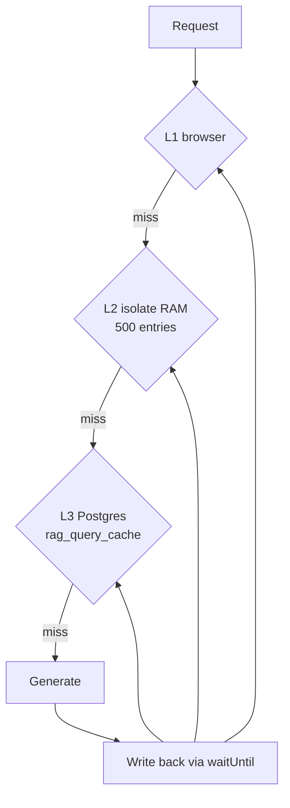
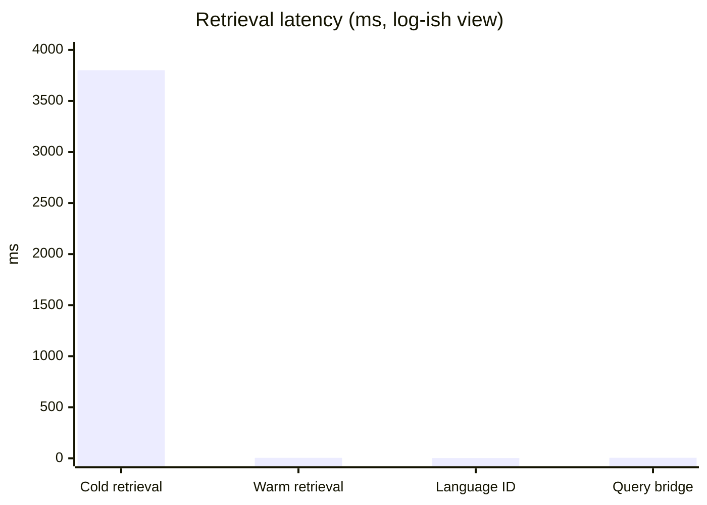
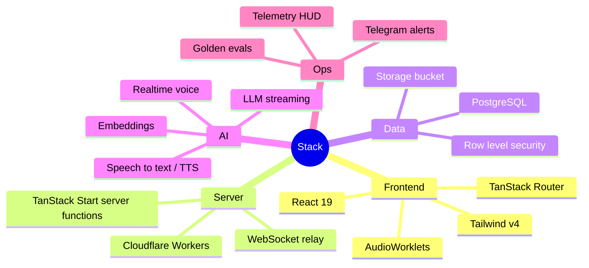

<div align="center">

# Daniyal.online — Voice AI & Hybrid RAG Portfolio

**An interactive portfolio for Mohd Daniyal, Full Stack AI Engineer. Recruiters can ask questions by text or live voice and get cited answers.**

[](https://daniyal.online)


</div>

---

## Features

| | Feature | Details |
|---|---|---|
| 🎙️ | **Real-time voice calls** | WebRTC voice, AudioWorklet VAD, barge-in, answers start on the first clause |
| 🔎 | **Hybrid RAG** | BM25 + embeddings fused with Reciprocal Rank Fusion, inline citations |
| 🌐 | **Multilingual** | Deterministic language detection (Hindi, Hinglish, Spanish, French, Japanese and more), cross-lingual query bridge |
| 🗣️ | **Voice personas** | 4 switchable voices, pre-recorded previews, read-aloud for every answer |
| ⚡ | **3-tier cache** | Browser RAM/localStorage → isolate hot RAM → Postgres query cache |
| 📊 | **Telemetry HUD** | `Ctrl+Shift+D` latency breakdown and automated self-tests |
| 🧪 | **Evaluation** | Golden test set scoring answer quality, citation coverage, recall and latency |
| 🛡️ | **Admin console** | Visitor sessions, chat histories, knowledge-base editing with PDF ingestion, resume upload |
| 📨 | **Owner alerts** | Telegram notifications for visits, chats and voice turns |

---

## System architecture



---

## Text question flow



---

## Live voice pipeline



**Guards:** idle cutoff, 5-minute call budget, guardrail checks, monotonic `turn_id` so stale audio is never played.

---

## Hybrid retrieval



The corpus is built from structured portfolio data plus admin-added documents. Embeddings are keyed by content hash, so edited content re-embeds automatically.

---

## Caching hierarchy



Only standalone, public-vocabulary answers generated without history are shared between visitors. Keys include corpus, prompt and model versions.

---

## Latency profile (local measurements)



| Stage | Typical |
|---|---|
| Language detection | < 2 ms |
| Cross-lingual bridge | < 5 ms |
| Hot retrieval | 2–5 ms |
| Cold retrieval | ~3.8 s |
| Initial eval: answer quality / citation coverage / retrieval recall | 92% / 75% / 100% |

---

## Tech stack



---

## Project structure

```text
src/
├── lib/
│   ├── portfolio.ts             # Single source of truth for content
│   ├── retrieval.ts             # BM25 + embeddings + RRF
│   ├── multilingualVoiceEngine.ts
│   ├── language.ts / voice-logic.ts / speech.ts
│   ├── golden.ts / eval-metrics.ts
│   └── prompt.ts
├── routes/
│   ├── index.tsx                # Portfolio + inline assistant
│   ├── chat.$threadId.tsx
│   ├── eval.tsx
│   ├── _authenticated/admin.tsx
│   └── api/                     # chat, live, speak, transcribe, eval, public/*
├── components/                  # thread-view, telemetry HUD, voice switcher…
└── hooks/                       # use-live-voice, use-speech
public/
├── voice-worklets.js            # VAD + playback worklets
└── voice-previews/              # Pre-recorded persona samples
```

---

## Getting started

```sh
git clone <this-repository-url>
cd <repository-name>
bun install        # or npm i
bun run dev        # http://localhost:8080
bunx vitest run    # tests
```

Set `VITE_SUPABASE_URL` and `VITE_SUPABASE_PUBLISHABLE_KEY` in `.env`, plus server-side AI and Telegram keys.

---

<div align="center">

**Mohd Daniyal** · Full Stack AI Engineer
[daniyal.online](https://daniyal.online) · [daniyallko@gmail.com](mailto:daniyallko@gmail.com)

</div>
